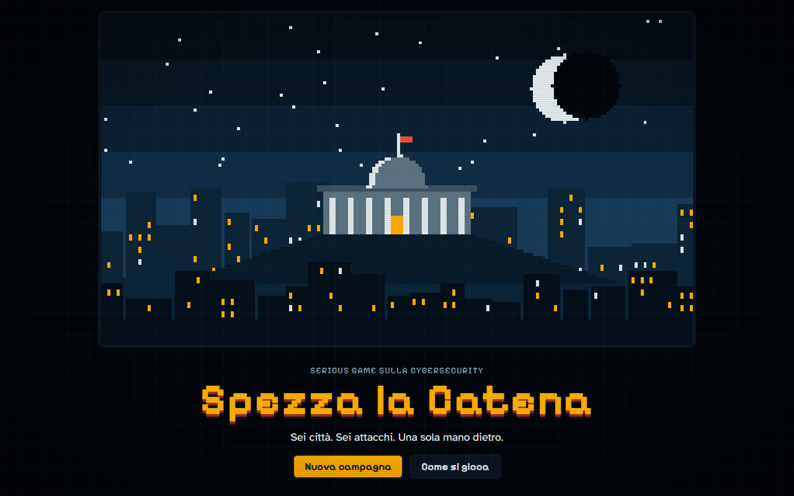
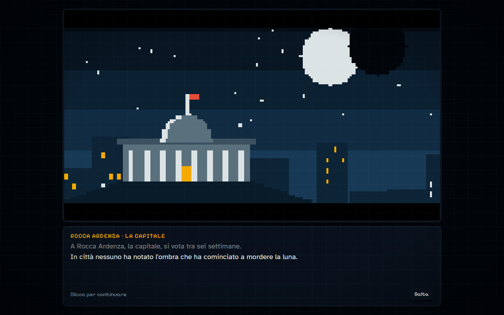
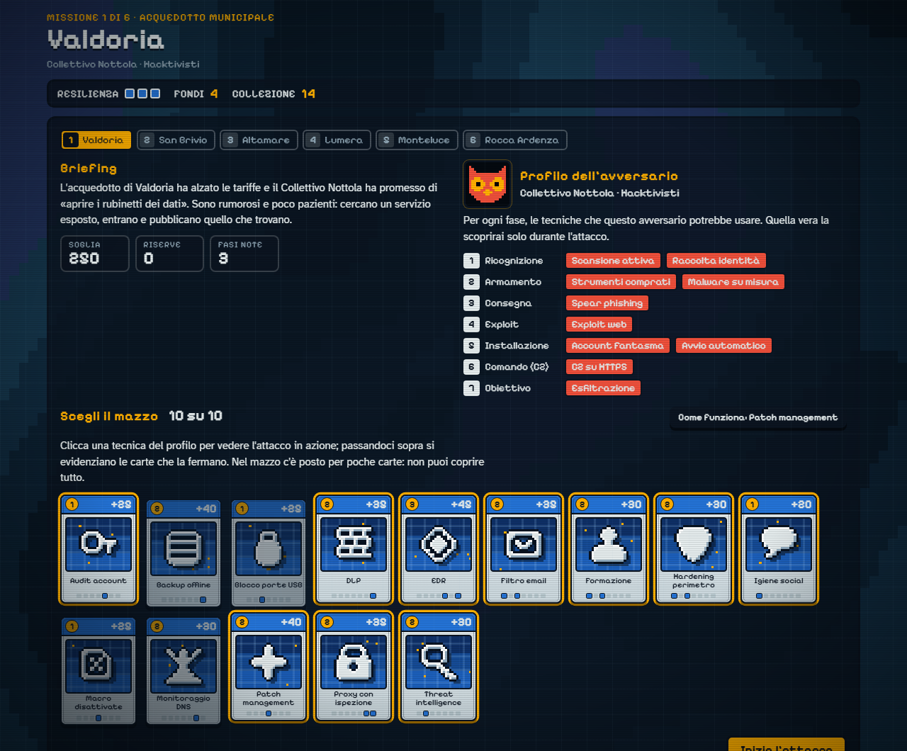
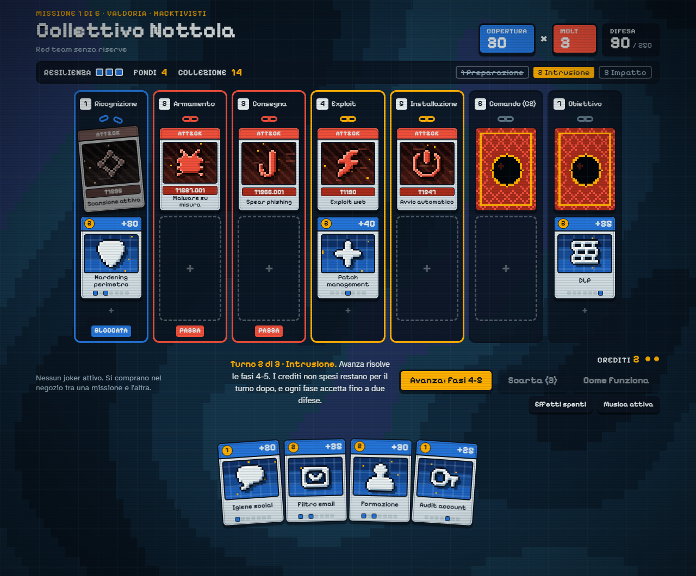
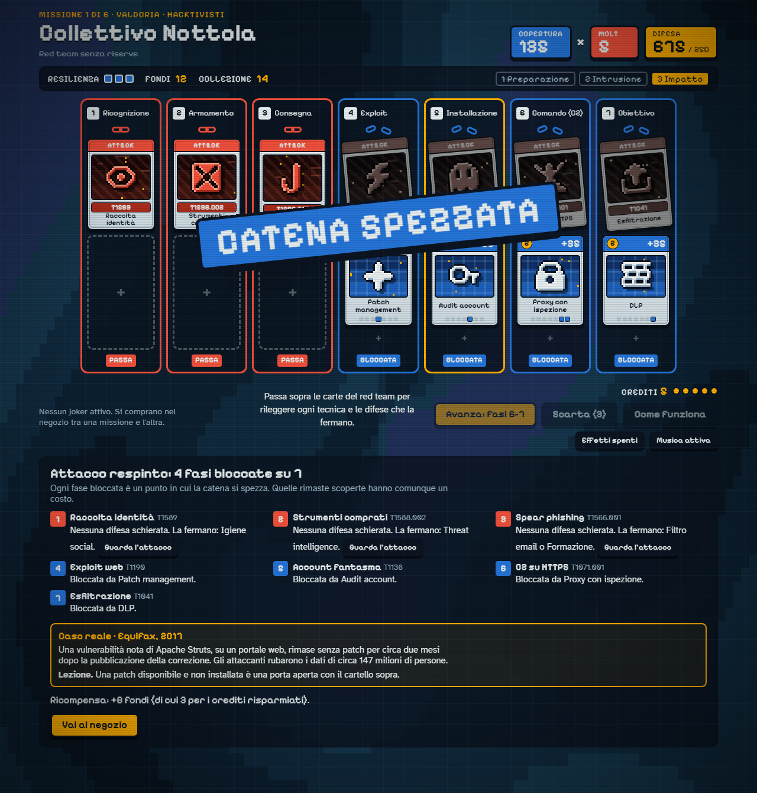
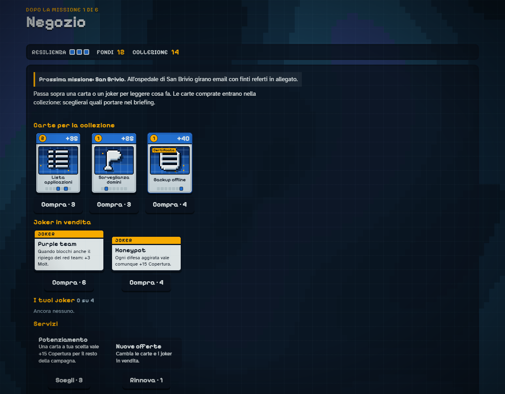
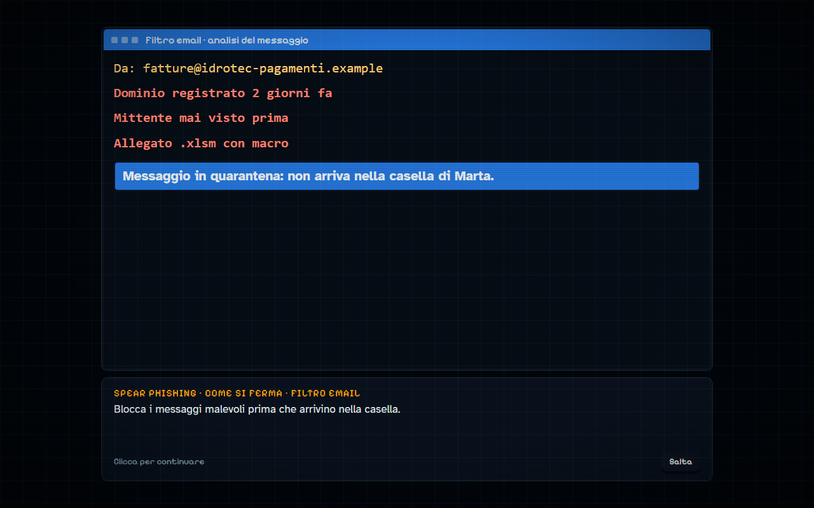

# Spezza la Catena

A serious game about cybersecurity. You lead a national incident response team through a six-mission campaign, building a deck of defenses and using it to break the attacker's kill chain before it reaches its objective.

Built for a university course on serious games for cybersecurity. The game interface is in Italian.

## What the game teaches

- **The Cyber Kill Chain.** Every attack plays out over the seven phases, from reconnaissance to action on objectives. Each blocked phase forces the attacker into the open, revealing the next hidden card, and an attack is lost whenever phase 7 gets through, whatever the score.
- **Real attacker techniques.** The 22 attack cards are MITRE ATT&CK techniques, each shown with its ID.
- **Defense in depth.** Attackers hold reserves and switch technique when blocked. A phase only scores if a second, different control stops the fallback too, so a single control per phase is not enough.
- **Risk management.** The deck is small and credits are limited: the player cannot cover everything and has to decide what to protect. Shadow IT and legacy systems are technical debts: accepted in the shop for funds now, they leave a weak spot until paid off.
- **Real incidents.** Each mission is modelled on a documented case (Equifax, the Irish health service, Colonial Pipeline, Target, the Ukrainian power grid, NotPetya), summarised in the debrief.

## Game flow

### 1. Cutscene

Each mission opens with a short animated sequence introducing the city, what is at stake, and the adversary.

### 2. Briefing and deck selection

The briefing shows the adversary profile: the techniques it may use in each phase, with some phases left unknown in later missions. The player picks 10 cards from their collection.

### 3. Attack

The attack resolves in three turns. The player spends credits to place defenses on the phases where they act, or has the SOC reveal a hidden attack card (the first analysis each turn is free). Under each hidden card the possible techniques from the adversary profile are listed. Each block adds to coverage and multiplier; their product must reach the mission threshold, and phase 7 must be stopped. From mission 3 on the game no longer says which defenses stop a technique, except in the debrief.

### 4. Debrief

The debrief lists what happened in each phase and which defenses would have stopped the techniques that got through, followed by the consequences carried into the next mission and the real-world case.

### 5. Shop

Between missions the player buys new cards, jokers that change the rules for the rest of the campaign, and upgrades.

### Simulations

Every attack and defense card opens a step-by-step simulation with a concrete example: the phishing email, the files being encrypted, the mail filter quarantining the message.

## Running the game

No build step and no dependencies. Open `index.html` in a browser, or serve the folder with any static host (GitHub Pages works as is).

Progress is saved in the browser's local storage at every briefing, in the shop (offers included), and during an attack at the start of each turn and after every SOC analysis or discard. Reloading the page resumes the same attack and does not undo a defeat.

## Project structure

| Path | Contents |
|---|---|
| `index.html` | Page markup |
| `css/style.css` | All styling and CSS animations |
| `js/data.js` | Game content: phases, techniques, defenses, jokers, missions, icons, emblems |
| `js/sims.js` | The concrete examples shown in the simulations |
| `js/game.js` | Rules: campaign, deck selection, turn resolution, jokers, shop, saving |
| `js/ui.js` | Card rendering and shared UI helpers |
| `js/scenes.js` | Pixel-art scenes for the cutscenes, drawn in code |
| `js/cutscene.js` | Cutscene and simulation player, title screen |
| `js/fx.js` | Particle effects |
| `js/audio.js` | Sound effects and music, synthesised with the Web Audio API |
| `js/bg.js` | Animated background |
| `js/autotest.js` | Development tool, see below |

All graphics and audio are generated in code; the repository contains no image or sound assets other than the README screenshots.

## Adding content

Most content lives in `js/data.js` and needs no changes to the game logic:

- **Defense:** add an entry to `DEFS` with cost, points, icon and the list of techniques it stops.
- **Technique:** add an entry to `TECH` under its phase, a `SIM` entry, and two windows in `js/sims.js`.
- **Mission:** add an entry to `FOES` with the city, the story text, the pool of techniques per phase, and the real-world case.
- **Joker:** add an entry to `JOKERS`, then implement its effect in `js/game.js` (search for `has('`).
- **Icon:** add eight rows of eight characters to `ICONS`, where `#` is a filled pixel.

## Automated playthrough

Opening `index.html?autotest` makes the game play a full campaign on its own and print a summary at the bottom of the page. It is a quick check that a change has not broken the game flow. `?autotest=prep`, `play`, `debrief` and `shop` stop at the corresponding screen.

## Notes

- The simulations are simplified for teaching purposes. Names, domains and addresses in them are fictional and use reserved example ranges.
- Adversary groups and locations are fictional. The real-world cases cited in the debriefs are public incidents.
- Mission thresholds were set with a scripted balance simulation (random play wins at most about 14% of missions from mission 2 on); they have not been tuned through playtesting yet.
