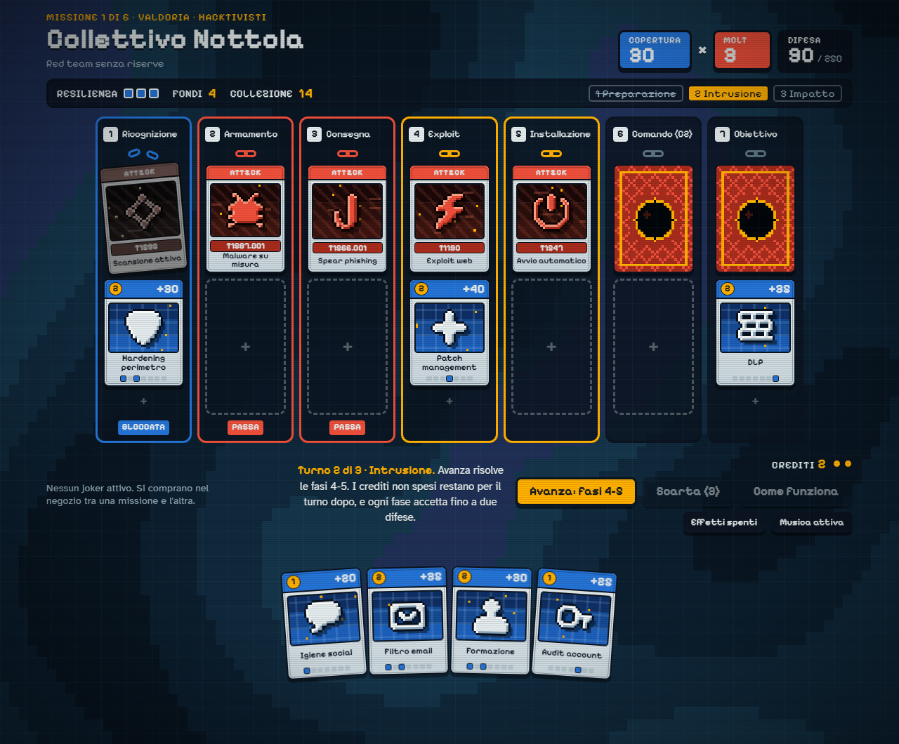

# Spezza la Catena (Break the Chain): game concept

> **Draft.** This document presents the idea of the game. It is not the final documentation: the detailed design is in [`docs/design/`](design/README.md).

| | |
|---|---|
| **Course** | Serious Games for Cyber-Security, University of Bari Aldo Moro |
| **Authors** | *to be completed* |
| **Genre** | Single-player strategy card game with a story campaign |
| **Platform** | Web browser, no installation |
| **Language** | Italian |

## Logline

A deck-building strategy game in which you lead a national incident response team and break the attacker's kill chain before it reaches its target.

## Abstract

*Spezza la Catena* (Break the Chain) is a single-player serious game about cyber defense, playable in the browser. The player leads Scudo, the national incident response team of a small fictional country, through a campaign of six attacks on its critical infrastructure: a water utility, a hospital, a fuel terminal, a bank, a power plant and, finally, the night of the national election.

Every attack unfolds along the seven phases of the Cyber Kill Chain, and every move of the attacker is a real MITRE ATT&CK technique. The player answers with a small deck of security controls, places each one on the phases where it acts, and tries to break the chain before the attacker reaches its objective. The deck and the budget are limited, so the player cannot protect everything and has to decide what to defend.

After each attack, a debrief explains what got through, which control would have stopped it, and which real incident the mission reproduces. The game aims to teach the structure of an attack, the match between techniques and controls, defense in depth, and risk-based decisions under limited resources.



## Motivation

Security awareness training usually teaches isolated rules ("do not open unexpected attachments", "turn on multi-factor authentication") and presents security controls one at a time. Real incidents do not look like that. An attacker studies the target, prepares the tools, gets in, settles, takes control and only then acts, and each of these steps is a chance to stop them. Defenders, meanwhile, never have the budget to protect everything.

A game can let players experience the chain and the trade-offs instead of reading about them: choosing a control, watching it hold or fail, and seeing the consequences carry into the next attack.

## Target players

Players with general computer literacy and no specialist security training, such as university students in computing or non-security staff of an organisation. No prior knowledge of the Cyber Kill Chain or of MITRE ATT&CK is required.

## Learning objectives

After playing, the player should be able to:

1. **Name** the seven phases of the Cyber Kill Chain and explain why stopping an attack early is worth more.
2. **Match** common attacker techniques with the security controls that stop them.
3. **Apply** defense in depth against an attacker who changes technique when blocked.
4. **Decide** which risks to cover and which to accept when resources are limited.

## The game in brief

**Setting.** The Republic of Calvera is small and highly connected: water, hospitals, energy and banks all depend on the network. Six weeks before the election, six cities are attacked one after another by groups that look unrelated: hacktivists, a ransomware gang, organised crime, a supply-chain specialist, a state-sponsored group. After each mission the player finds a clue linking them, until the final attack on election night reveals the operation behind them all.

**Core loop.**

```text
Cutscene  ->  Briefing and deck  ->  Attack in 3 turns  ->  Debrief  ->  Shop
   ^                                                                      |
   +--------------------------------- next mission -----------------------+
```

1. **Briefing.** The player reads the adversary profile, the techniques it may use in each phase, and picks 10 defense cards from the collection.
2. **Attack.** Three turns cover the seven phases. Each turn the player receives credits, places defenses on the phases where they act, or pays the SOC to reveal a hidden attack card. Each block raises the score, which must reach the mission threshold.
3. **Debrief.** The outcome of each phase, the controls that would have worked, the consequences for the next mission and the real incident behind the mission.
4. **Shop.** New controls, jokers that change the rules (each one a real security practice), and upgrades.

**Win and loss.** A mission is won by reaching the threshold. Each lost mission costs one of three points of Resilience. The campaign is won by holding until election night.

## How the game teaches

Learning is built into the rules rather than added on top of them. Each core mechanic is a security concept:

| Mechanic | Concept it teaches |
|---|---|
| The board is seven columns, one per kill-chain phase, resolved in order | The structure of an attack |
| A defense card can only be placed in the phases where the control acts, and blocks only the techniques it really stops | Which control stops which technique |
| A block in the first three phases is worth more; unblocked phases leave a backdoor or stolen data for the next mission | Early disruption and the lasting cost of a breach |
| When blocked, the attacker spends a reserve and switches technique; two different controls on the same phase stop both | Adaptive adversaries and defense in depth |
| A deck of only 10 cards and a few credits per turn | Risk management under limited resources |
| An adversary profile with gaps, and a SOC that reveals hidden cards for a price | Threat intelligence and the cost of visibility |
| A debrief with the real incident behind each mission | The link between the game and the real world |

Every technique and every control can also be opened as a short step-by-step simulation: a phishing email arriving, files being encrypted, a mail filter quarantining the message.

## Inspiration

### Balatro

*Balatro* (LocalThunk, 2024) is a roguelike deck-builder built on poker hands. It shows that a simple numeric loop can be deeply engaging when choices combine in visible ways. *Spezza la Catena* borrows its game structure:

- a score made of two factors multiplied together (Coverage × Mult), to be raised above a threshold that grows from mission to mission;
- jokers that change the rules for the rest of the campaign, card editions, a shop between rounds and a limited number of discards;
- short campaigns with enough randomness that no two are the same.

What changes is the meaning of every element. Cards are not playing cards but real security controls, and their value depends on where they are placed on the kill chain and on what the attacker does. The combinations that raise the score are the security concepts themselves: blocking early, layering two controls on one phase. Each joker is a real security practice (honeypot, Zero Trust, purple team, bug bounty, cyber insurance) and comes with a line explaining what it means in reality. All names, graphics and sounds are original.

### Locked Shields

*Locked Shields* is the live-fire cyber defense exercise organised every year since 2010 by the NATO Cooperative Cyber Defence Centre of Excellence (CCDCOE). National blue teams defend the IT systems and the critical infrastructure of a fictional country against a red team, in a scenario that combines technical attacks with strategic, legal and communication decisions. Unlike a classic capture-the-flag, the goal is not to break into systems but to keep a country running under attack. *Spezza la Catena* takes from it:

- the point of view of the defender rather than the attacker;
- a fictional nation whose critical services (water, health care, energy, finance, elections) are attacked in an escalating scenario;
- the red team versus blue team framing, which becomes the colour code of the whole game: red attack cards, blue defense cards;
- the idea that failures have consequences that carry forward, and that every attack ends with a review of what went wrong.

What changes is the scale: a single player, turn-based play, and a red team simulated by the game, so that the experience is accessible to people with no technical background.

### Content frameworks

The content of the game comes from two public frameworks and from documented incidents:

- the **Cyber Kill Chain** of Lockheed Martin, which gives the seven phases of the board;
- **MITRE ATT&CK**, from which come the 22 attack techniques and their identifiers;
- six **real incidents**, one per mission: Equifax (2017), the Irish health service (2021), Colonial Pipeline (2021), Target (2013), the Ukrainian power grid (2015) and NotPetya (2017).

## Evaluation plan

The game will be evaluated with a beta test on a sample of target players:

1. Observation of each player during a play session, without interruptions.
2. A short interview at the end of the session.
3. The MEEGA+ questionnaire for usability, player experience and perceived learning, with one learning item for each objective.
4. Optionally, a short test before and after playing: list the kill-chain phases, assign techniques to phases, match techniques with controls.

## Status and next steps

A playable prototype is complete: six missions with cutscenes, 22 techniques, 20 controls, 11 jokers, step-by-step simulations and automatic saving. The next steps are:

- running the beta test described above;
- tuning the mission thresholds on the results;
- adding an in-game menu with a confirmed exit, and the credits on the title screen;
- reviewing how a block followed by a successful fallback is scored.

## References

- Hutchins, E. M., Cloppert, M. J., & Amin, R. M. (2011). *Intelligence-driven computer network defense informed by analysis of adversary campaigns and intrusion kill chains.* Lockheed Martin Corporation.
- MITRE. *ATT&CK knowledge base.* <https://attack.mitre.org>
- NATO CCDCOE. *Locked Shields.* <https://ccdcoe.org/exercises/locked-shields/>
- LocalThunk (2024). *Balatro* [video game]. Playstack.
- Schell, J. (2008). *The Art of Game Design: A Book of Lenses.* CRC Press.
- Petri, G., von Wangenheim, C. G., & Borgatto, A. F. (2016). *MEEGA+: An evolution of a model for the evaluation of educational games.* INCoD/GQS.
