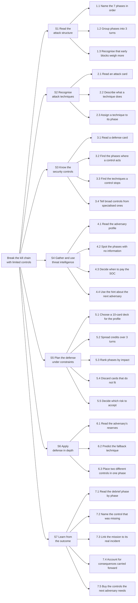

# 2. Task analysis

The task analysis breaks the main skill the game teaches into component skills, down to elementary skills. The tree is used to decide the order in which the game introduces its mechanics (section 2.4) and the order of the missions ([Mission design](03-mission-design.md)).

## 2.1 Main skill

> **Break an attacker's kill chain with a limited set of security controls.**
>
> Given an adversary profile, a collection of controls and a budget, the player chooses and places controls so that enough phases of the attack are blocked to keep the organisation safe.

## 2.2 Skill tree

The main skill has seven component skills (S1-S7). The leaves of the tree are the **entry-level skills**: the smallest units of competence the game teaches directly, each one practised by a single action or reading on screen.

The same tree as an outline:

- **Break the kill chain with limited controls**
  - **S1. Read the attack structure**
    - 1.1 Name the seven phases of the kill chain in order.
    - 1.2 Group the phases into the three turns: Preparation (1-3), Intrusion (4-5), Impact (6-7).
    - 1.3 Recognise that a block in phases 1-3 is worth more than a later one.
  - **S2. Recognise attack techniques**
    - 2.1 Read an attack card: name, MITRE ATT&CK ID, phase.
    - 2.2 Describe what a technique does, from its simulation.
    - 2.3 Assign a technique to its kill-chain phase.
  - **S3. Know the security controls**
    - 3.1 Read a defense card: cost, Coverage points, phase pips, edition.
    - 3.2 Find the phases where a control can be placed.
    - 3.3 Find the techniques a control stops.
    - 3.4 Tell broad controls (for example training, EDR, the inspecting proxy) from specialised ones (for example USB port blocking).
  - **S4. Gather and use threat intelligence**
    - 4.1 Read the adversary profile in the briefing.
    - 4.2 Spot the phases marked "No information".
    - 4.3 Decide when it is worth paying the SOC to reveal an attack card.
    - 4.4 Use the hint about the next adversary shown in the shop.
  - **S5. Plan the defense under constraints**
    - 5.1 Choose a 10-card deck that matches the profile.
    - 5.2 Spread the credits over the three turns, using carry-over.
    - 5.3 Rank the phases by impact: early phases, Installation (backdoor) and Actions on Objectives (damage).
    - 5.4 Discard cards in hand that do not fit the threat.
    - 5.5 Decide which risk to accept when not everything can be covered.
  - **S6. Apply defense in depth**
    - 6.1 Read how many reserves the adversary has.
    - 6.2 Predict the fallback technique from the profile.
    - 6.3 Place two different controls in the same phase so that both techniques are stopped.
  - **S7. Learn from the outcome**
    - 7.1 Read the debrief phase by phase.
    - 7.2 Name the control that would have stopped each technique that got through.
    - 7.3 Link the mission to its real incident and lesson.
    - 7.4 Account for the consequences carried into the next mission.
    - 7.5 Buy the controls that the next adversary is likely to need.

### Prerequisites

The following skills sit below the tree: the game assumes them and does not teach them.

- Using a mouse or a touch screen to click and select.
- Reading short texts in Italian.
- Everyday familiarity with email, attachments, websites, passwords and USB drives.
- Adding and multiplying two-digit and three-digit numbers.

## 2.3 Where each skill is practised

| Skill | Screen | Player action | Feedback the game gives |
|---|---|---|---|
| 1.1 | Attack | Places a card in a column | Valid columns are highlighted; a wrong column shakes the card and explains why |
| 1.2 | Attack | Presses *Avanza* | The turn tracker and the active columns show which phases resolve |
| 1.3 | Attack | Blocks in phases 1-3 | Mult +2 instead of +1, screen shake |
| 2.1 | Attack, briefing | Reads a revealed card | Hover text: name, ID, description, controls that stop it |
| 2.2 | Simulation | Clicks a technique | Network diagram, then two windows with the attack in progress |
| 2.3 | Briefing | Reads the profile | Techniques are listed under their phase |
| 3.1 | Briefing, attack | Hovers a defense card | Hover text: cost, value, description, techniques it stops |
| 3.2 | Attack | Selects a card | The columns where it acts are highlighted |
| 3.3 | Briefing | Hovers a technique chip | The cards that stop it are highlighted in the collection |
| 3.4 | Simulation | Clicks *Come funziona* | One window per technique the control stops |
| 4.1 | Briefing | Reads the profile | Techniques per phase, threshold, reserves, known phases |
| 4.2 | Briefing | Reads the profile | "No information" chip on hidden phases |
| 4.3 | Attack | Clicks a face-down card | Card revealed, credits spent |
| 4.4 | Shop | Reads the teaser | "Next mission" line with a hint about the adversary |
| 5.1 | Briefing | Selects 10 cards | Counter "n of 10"; *Inizia l'attacco* enabled only at 10 |
| 5.2 | Attack | Spends or keeps credits | Credit counter; leftover credits carried to the next turn |
| 5.3 | Attack, debrief | Chooses where to place | Consequences listed in the debrief |
| 5.4 | Attack | Presses *Scarta* | A new card is drawn; three discards per mission |
| 5.5 | Attack | Leaves phases uncovered | Verdict *Passa* on the phase, explanation in the debrief |
| 6.1 | Attack | Reads the header | Reserve pips under the adversary's name |
| 6.2 | Briefing | Reads the second technique of a phase | Fallback card revealed when a reserve is spent |
| 6.3 | Attack | Places two cards in one phase | Verdict *Doppio blocco*, or *Ripiego riuscito* if the second control does not fit |
| 7.1 | Debrief | Reads the list | One line per phase with the outcome |
| 7.2 | Debrief | Reads the list | "Stopped by: …" on every phase that got through, with *Guarda l'attacco* |
| 7.3 | Debrief | Reads the box | Real case, what happened, lesson |
| 7.4 | Debrief, briefing | Reads the notes | Consequences listed in the debrief and repeated in the next briefing |
| 7.5 | Shop | Buys cards | Cards the next mission needs are offered first |

## 2.4 Order of introduction

The tree is taught from the bottom up and from left to right: reading the board and the cards first, planning and adaptation later. Each mission adds the skills it needs and keeps the earlier ones in play.

| Mission | Skills introduced | Why at this point |
|---|---|---|
| 1. Valdoria | 1.1-1.3, 2.1-2.3, 3.1-3.3, 4.1, 5.1-5.5, 7.1-7.4 | The adversary has no reserves and three phases are known: the player can learn the board, the cards and the score without being surprised. |
| Shop 1 | 4.4, 7.5 | First chance to buy controls; the teaser announces phishing at the hospital. |
| 2. San Brivio | 4.2, 4.3, 6.1-6.3 | First reserve and first hidden phase: the attacker adapts, and visibility starts to cost credits. |
| 3. Altamare | 3.4 | Two reserves; stolen credentials are stopped only by MFA, which is not in the starting collection: the player learns that some techniques have one specific answer, and that broad controls do not cover everything. |
| 4. Lumera | consolidation of S4 and S6 | Two hidden phases and a supply-chain profile: the player must read the profile and the shop hint carefully. |
| 5. Monteluce | consolidation of S4, S5 | First boss rule: SOC analysis costs 2 credits, so intelligence must be spent where it matters most. |
| 6. Rocca Ardenza | all skills | Five hidden phases, three reserves, one card and one credit fewer per turn: the final test of the whole tree. |
