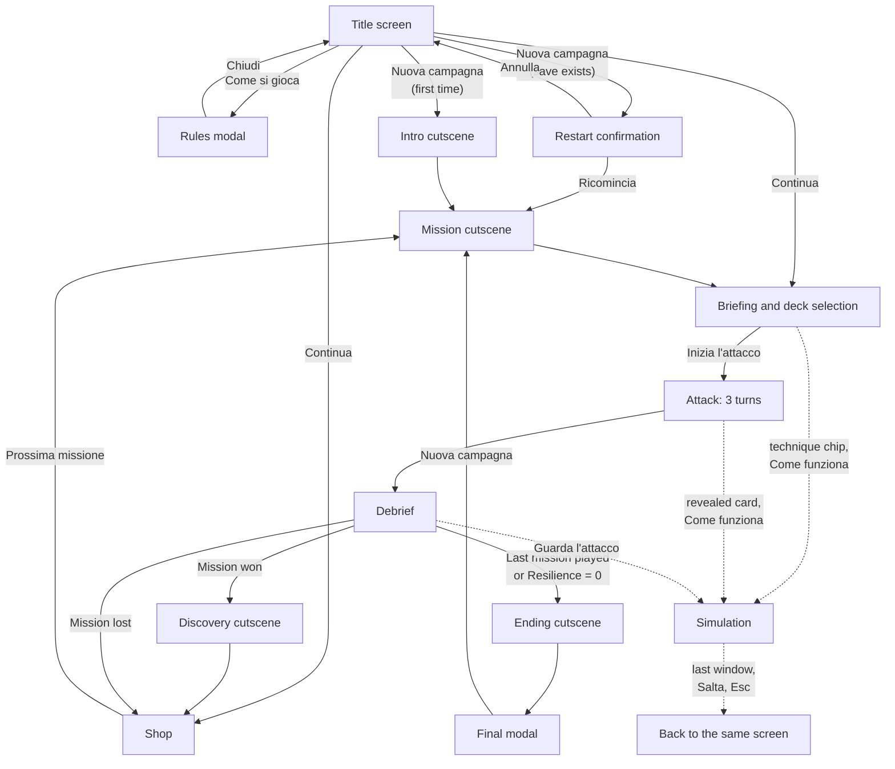
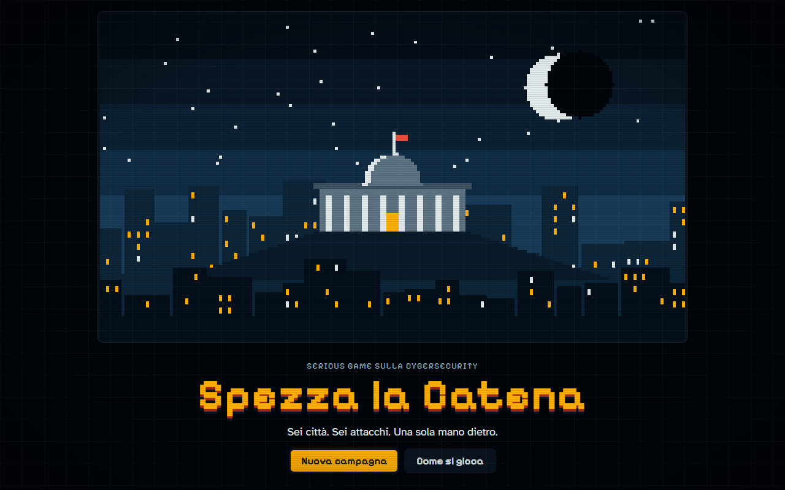
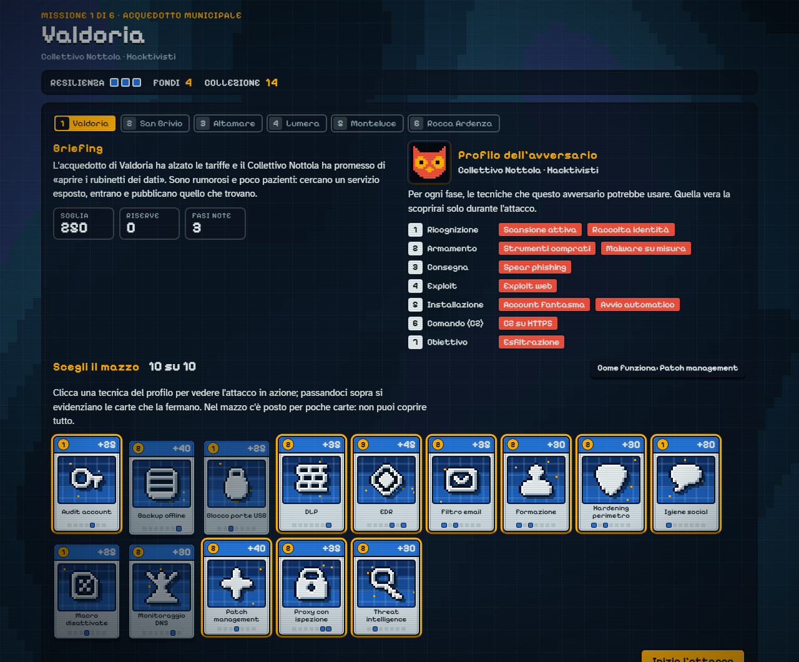
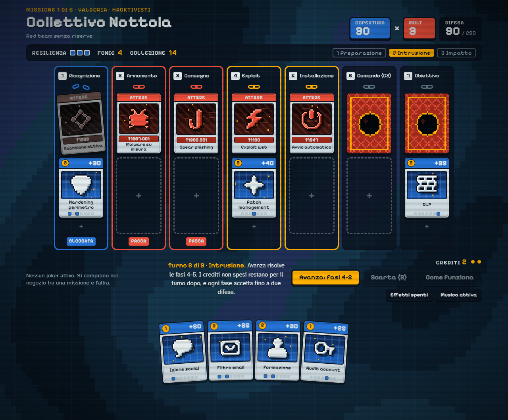
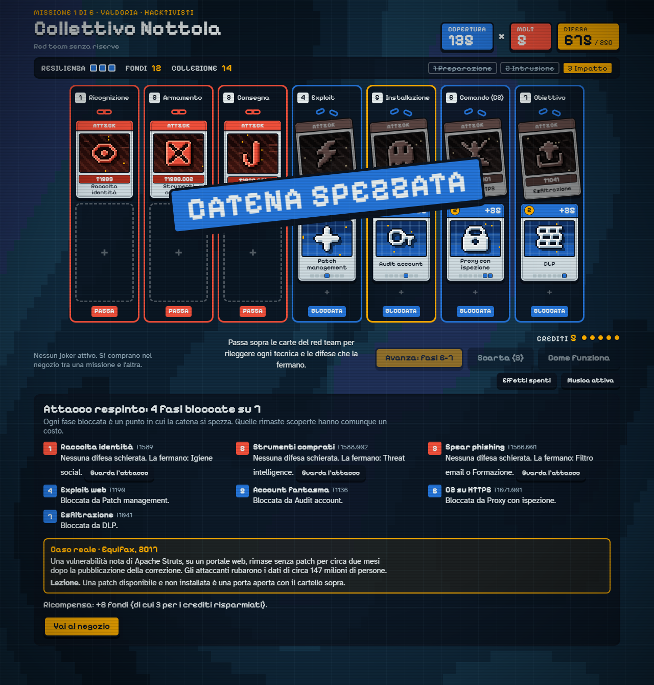
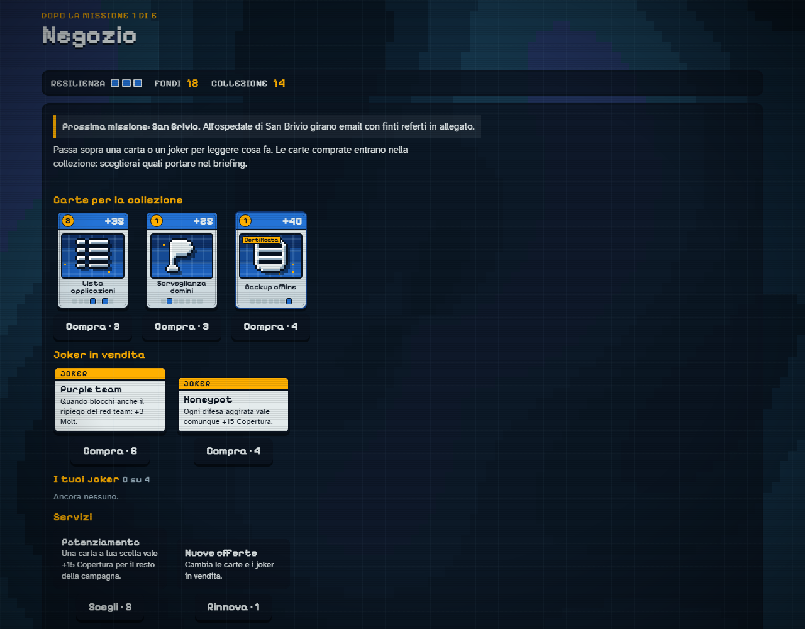
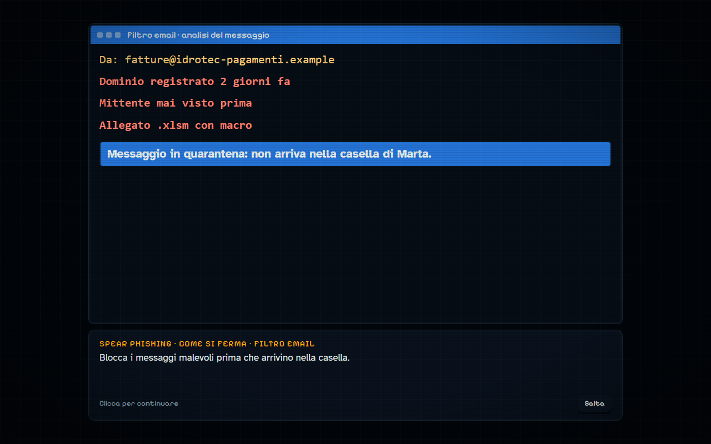

# 4. Prototypes and storyboards

This document describes every screen of the game at two levels of detail:

- **Low-fidelity prototype:** a wireframe that shows the functional areas of the screen and their position.
- **Storyboard:** the texts, graphic elements and navigation links of the screen, with a high-fidelity screenshot of the implemented build where available.

Cutscenes are described as shot lists (section 4.4).

## 4.1 Screen flow



Solid arrows change screen; dotted arrows open the simulation as an overlay that returns to the screen it was opened from. Every cutscene and simulation can be closed at any point with *Salta* or Esc. The game saves automatically when the briefing and the shop open: *Continua* resumes from the screen that was saved, briefing or shop.

## 4.2 Layout principles

All game screens share the same frame, so that information is always in the same place:

```text
+--------------------------------------------------------------------------+
| HEADER       eyebrow: mission and place                 score / context  |
|              title: adversary, city or "Negozio"                         |
+--------------------------------------------------------------------------+
| STATUS BAR   Resilience  Funds  Collection                turn tracker   |
+--------------------------------------------------------------------------+
|                                                                          |
| CONTENT      board (attack) | briefing (prep) | offers (shop)            |
|                                                                          |
+--------------------------------------------------------------------------+
| INFO LINE    context-sensitive help: changes on hover and on each action |
+--------------------------------------------------------------------------+
```

- **Colour code.** Red is the attacker (attack cards, phases that got through), blue is the defender (defense cards, blocked phases), amber marks what needs attention (current turn, threshold reached, rewards, the real-case box).
- **Fonts.** Pixelify Sans for titles and labels; Atkinson Hyperlegible, a font designed for readability, for all running text.
- **Context-sensitive help.** Hovering or focusing any card, chip or joker writes its explanation in the info line (rollover technique); the default text of the info line explains what to do next.
- **Active elements.** Valid drop columns are highlighted when a card is selected, disabled buttons are greyed out, and an invalid action shakes the element and explains why in the info line.
- **Accessibility.** Cards, slots and buttons can be reached and used from the keyboard and carry an `aria-label`; animations are reduced when the operating system asks for reduced motion.

## 4.3 Screens

### 4.3.1 Title screen

**Purpose.** Introduce the game, let the player start, resume or read the rules.

```text
+--------------------------------------------------------------------------+
|                                                                          |
|      [ animated pixel-art night view of the capital, eclipsed moon ]     |
|                                                                          |
|                  SERIOUS GAME SULLA CYBERSECURITY                        |
|                                                                          |
|                      S P E Z Z A   L A   C A T E N A                     |
|                                                                          |
|               Sei città. Sei attacchi. Una sola mano dietro.             |
|                                                                          |
|        [ Continua · missione N ]  [ Nuova campagna ]  [ Come si gioca ]  |
|                                                                          |
+--------------------------------------------------------------------------+
```

| Element | Content | Behaviour |
|---|---|---|
| Background | Pixel-art view of Rocca Ardenza at night, the moon 70% eclipsed | Animated loop |
| Kicker | "Serious game on cybersecurity" | Static |
| Title | *Spezza la Catena* (Break the Chain) | Static |
| Tagline | "Six cities. Six attacks. One hand behind them all." | Static |
| *Continua · missione N* | Resume the saved campaign at mission N | Shown only when a save exists |
| *Nuova campagna* | Start a new campaign | Asks for confirmation if a save exists |
| *Come si gioca* | Open the rules modal | Modal with six rules: prepare, deploy, investigate, advance, watch the reserves, reinforce |

**Navigation.** Intro cutscene (first new campaign), mission cutscene, briefing or shop (resume), rules modal.



### 4.3.2 Briefing and deck selection

**Purpose.** Present the adversary (threat intelligence) and let the player choose the 10 cards to bring.

```text
+--------------------------------------------------------------------------+
| MISSIONE 1 DI 6 · ACQUEDOTTO MUNICIPALE                                  |
| Valdoria                                                                 |
| Collettivo Nottola · Hacktivisti                                         |
+--------------------------------------------------------------------------+
| Resilienza [■][■][■]   Fondi 4   Collezione 14                           |
+--------------------------------------------------------------------------+
| (1 Valdoria) (2 San Brivio) (3 Altamare) (4 Lumera) (5 ...) (6 ...)      |
|                                                                          |
| BRIEFING                            | [emblem] PROFILO DELL'AVVERSARIO   |
| Story of the mission, 2-3 lines     | 1 Ricognizione  [chip] [chip]      |
|                                     | 2 Armamento     [chip] [chip]      |
| +--------+ +--------+ +----------+  | 3 Consegna      [chip]             |
| |SOGLIA  | |RISERVE | |FASI NOTE |  | 4 Exploit       [chip]             |
| |  250   | |   0    | |    3     |  | 5 Installazione [chip] [chip]      |
| +--------+ +--------+ +----------+  | 6 Comando (C2)  [Nessuna informaz.]|
| Boss rule / consequence notes       | 7 Obiettivo     [chip]             |
+--------------------------------------------------------------------------+
| SCEGLI IL MAZZO   10 su 10                     [ Come funziona: <card> ] |
| Info line                                                                |
| [card] [card] [card] [card] [card] [card] [card] [card] [card] [card]    |
| [card] [card] [card] [card]                                              |
|                                                    [ Inizia l'attacco ]  |
+--------------------------------------------------------------------------+
```

| Element | Content | Behaviour |
|---|---|---|
| Route | The six cities; past ones dimmed, the current one highlighted | Content map of the campaign |
| Briefing text | Who is attacking, what they want, how they usually act | Static |
| Facts | Threshold, reserves (plus one if a backdoor was left), known phases (zero after an exfiltration) | Values already include the consequences of the previous mission |
| Boss rule | Name and effect of the boss rule | Missions 5 and 6 only |
| Notes | Consequences carried from the previous mission | Shown only when present |
| Adversary profile | Emblem, name, type; per phase, one chip per possible technique, or "No information" | Hover a chip: explanation in the info line and the cards that stop it are highlighted. Click a chip: technique simulation |
| Deck counter | "n su 10" (n of 10) | Updates on every selection |
| Collection | All owned defense cards, alphabetical; selected cards have an amber frame | Click to add or remove; a full deck shakes the card and explains why |
| *Come funziona* | Simulation of the last card clicked | Disabled until a card is clicked |
| *Inizia l'attacco* | Start the attack | Enabled only with exactly 10 cards |

**Navigation.** Attack screen; simulation overlay.



### 4.3.3 Attack

**Purpose.** The core loop: place defenses on the kill chain, investigate, resolve the attack turn by turn.

```text
+--------------------------------------------------------------------------+
| MISSIONE 1 DI 6 · VALDORIA · HACKTIVISTI                                 |
| Collettivo Nottola          +-----------+   +------+   +---------------+ |
| Riserve del red team (o)(o) | COPERTURA | x | MOLT |   | DIFESA        | |
|                             |    80     |   |  3   |   |  240 / 250    | |
|                             +-----------+   +------+   +---------------+ |
+--------------------------------------------------------------------------+
| Resilienza [■][■][■]  Fondi 4  Collezione 14  [1 Prep] [2 Intr] [3 Imp]  |
+--------------------------------------------------------------------------+
| +------+ +------+ +------+ +------+ +------+ +------+ +------+           |
| |1 Ric.| |2 Arm.| |3 Con.| |4 Exp.| |5 Ins.| |6 C2  | |7 Obi.|  phase    |
| | o-o  | | o-o  | | o-o  | | o-o  | | o-o  | | o-o  | | o-o  |  chain    |
| |[RED] | |[RED] | |[RED] | |[RED] | |[RED] | |[RED] | |[RED] |  attack   |
| |      | |      | |      | |      | |      | |      | |      |           |
| |[BLUE]| | [+]  | | [+]  | |[BLUE]| | [+]  | | [+]  | |[BLUE]|  defenses |
| |      | |      | |      | |      | |      | |      | |      |  (max 2)  |
| |BLOCC.| |PASSA | |PASSA | |      | |      | |      | |      |  verdict  |
| +------+ +------+ +------+ +------+ +------+ +------+ +------+           |
+--------------------------------------------------------------------------+
| Jokers          | Info line: turn, phases, hints   | Crediti 2 (o)(o)    |
|                 |                                  | [Avanza: fasi 4-5]  |
|                 |                                  | [Scarta (3)]        |
|                 |                                  | [Come funziona]     |
|                 |                                  | [Effetti] [Musica]  |
+--------------------------------------------------------------------------+
|                 [card] [card] [card] [card] [card]   <- hand (fan)       |
+--------------------------------------------------------------------------+
```

| Element | Content | Behaviour |
|---|---|---|
| Score | Coverage × Mult = Defense, against the threshold | Numbers bounce when they change; the Defense box turns amber when the threshold is reached |
| Reserves | One red pip per reserve left | A pip goes out when the attacker switches technique |
| Turn tracker | Preparation, Intrusion, Impact | Current turn amber, past turns struck through |
| Phase column | Number and name, chain icon, attack card, up to two defense slots, verdict | Columns of the current turn are framed in amber; framed blue once blocked, red once passed |
| Attack card | Face down (pattern with the eclipse), or face up with icon, MITRE ID and name | Face down: click to pay the SOC. Face up: click to open the simulation |
| Defense slot | "+" when empty | Highlighted when the selected card can go there; click to drop the card |
| Defense card | Cost, Coverage, icon, name, seven phase pips, optional edition | Click in hand to select; click on the board to take it back and recover the credits |
| Verdict | *Bloccata* (blocked), *Doppio blocco* (double block), *Ripiego riuscito* (fallback succeeded), *Aggirata* (bypassed: wrong control), *Passa* (no defense) | Appears during resolution |
| Credits | Number and coins | Spent on placement and SOC, refunded when a card is taken back |
| *Avanza* | "Advance: phases x-y" | Resolves the phases of the turn one by one, with animation and sound |
| *Scarta (n)* | Discard the selected card and draw a new one | Three discards per mission |
| *Come funziona* | Simulation of the selected card | Enabled when a card is selected |
| Jokers | Active jokers | Hover for the effect and the real-world meaning; they flash when they trigger |
| Hand | 5 cards in a fan; one more with the *Esercitazione* joker, one fewer in the final mission | Refilled at the start of each turn |

**Resolution sequence of a phase.**

1. The column lights up; a face-down attack card flips.
2. If a placed control stops the technique: Coverage and Mult increase, with particles and a rising tone.
3. If the adversary has a reserve, the attack card burns and is replaced by the fallback technique. The second control is checked against it.
4. The verdict appears and the column turns blue (blocked) or red (passed).
5. After phase 7, the stamp *CATENA SPEZZATA* (chain broken) or *VIOLAZIONE* (breach) covers the board.

**Navigation.** Debrief, which opens below the board; simulation overlay.



### 4.3.4 Debrief

**Purpose.** Turn the outcome into learning: what happened in each phase, what would have worked, which real incident the mission reproduces.

```text
+--------------------------------------------------------------------------+
| [ board with the final verdicts and the stamp CATENA SPEZZATA ]          |
+--------------------------------------------------------------------------+
| ATTACCO RESPINTO: 4 FASI BLOCCATE SU 7                                   |
| One line explaining the result                                           |
|                                                                          |
| (1) Technique T-ID          (2) Technique T-ID       (3) Technique T-ID  |
|     Outcome. Stopped by: X.     Outcome...               Outcome...      |
|     [Guarda l'attacco]          [Guarda l'attacco]                       |
| (4) ...                     (5) ...                  (6) ...             |
| (7) ...                                                                  |
|                                                                          |
| CONSEGUENZE                                                              |
| - consequence carried to the next mission                                |
|                                                                          |
| +----------------------------------------------------------------------+ |
| | CASO REALE · <incident, year>                                        | |
| | What happened, 2 lines                                               | |
| | Lezione. One-line lesson                                             | |
| +----------------------------------------------------------------------+ |
| Ricompensa: +N fondi                                                     |
| [ Vai al negozio ]  or  [ Fine della campagna ]                          |
+--------------------------------------------------------------------------+
```

| Element | Content | Behaviour |
|---|---|---|
| Heading | Win: "Attack repelled: n phases blocked out of 7". Loss: "Breach: Defense x out of threshold" | Static |
| Phase log | One entry per phase: technique, ID, what happened, and for every phase that got through the controls that would have stopped it | Blue for blocked phases. *Guarda l'attacco* (watch the attack) opens the simulation of the technique that got through |
| Consequences | Backdoor, lost known phases, recovery cost, Resilience lost, insurance used | Shown only when present |
| Real case | Incident, description, lesson | Amber box |
| Reward | Funds earned, including the bonus for saved credits | Static |
| Button | *Vai al negozio* or *Fine della campagna* | Continues the campaign |

**Navigation.** Discovery cutscene and then the shop (win), shop (loss), ending cutscene (last mission or no Resilience left).



### 4.3.5 Shop

**Purpose.** Between missions, let the player strengthen the collection in view of the next adversary.

```text
+--------------------------------------------------------------------------+
| DOPO LA MISSIONE 1 DI 6                                                  |
| Negozio                                                                  |
+--------------------------------------------------------------------------+
| Resilienza [■][■][■]   Fondi 12   Collezione 14                          |
+--------------------------------------------------------------------------+
| | Prossima missione: <city>. <hint about the adversary>                  |
| Info line                                                                |
|                                                                          |
| CARTE PER LA COLLEZIONE                                                  |
|  [card]        [card]        [card + edition]                            |
| [Compra · 3]  [Compra · 3]  [Compra · 4]                                 |
|                                                                          |
| JOKER IN VENDITA                                                         |
|  [joker]       [joker]                                                   |
| [Compra · 6]  [Compra · 4]                                               |
|                                                                          |
| I TUOI JOKER  0 su 4                                                     |
|  [joker] [Vendi · +2]                                                    |
|                                                                          |
| SERVIZI                                                                  |
|  Potenziamento [Scegli · 3]     Nuove offerte [Rinnova · 1]              |
|                                                    [ Prossima missione ] |
+--------------------------------------------------------------------------+
```

| Element | Content | Behaviour |
|---|---|---|
| Teaser | Next city and a hint about the adversary | Static; it is the threat intelligence for the next mission |
| Cards | Up to two new controls at 3 funds, those the next mission needs first; one card with a special edition at 4 | Bought cards join the collection; the button becomes *Comprata* |
| Jokers | Two jokers not owned yet | Disabled when 4 jokers are owned or funds are insufficient |
| Your jokers | Owned jokers, up to 4 | *Vendi* gives back 2 funds |
| *Potenziamento* | +15 Coverage on one card for the rest of the campaign | Opens a picker with the collection |
| *Nuove offerte* | Re-rolls cards and jokers | Costs 1 fund |
| *Prossima missione* | Continue | Opens the next mission cutscene |

**Navigation.** Mission cutscene of the next mission.



### 4.3.6 Simulation overlay

**Purpose.** Show a technique or a control at work on a concrete, fictional example.

```text
+--------------------------------------------------------------------------+
| +----------------------------------------------------------------------+ |
| | o o o  <Application> · <what is shown>                               | |
| +----------------------------------------------------------------------+ |
| | Row 1 appears                                                        | |
| | Row 2 appears                                                        | |
| | Row 3 in red: the dangerous detail                                   | |
| | [ Row 4 in blue: the control stops it ]                              | |
| +----------------------------------------------------------------------+ |
| +----------------------------------------------------------------------+ |
| | TECHNIQUE · STEP n OF 2   or   TECHNIQUE · HOW TO STOP IT · CONTROL  | |
| | Caption, one or two lines                                            | |
| | Clicca per continuare                                       [Salta]  | |
| +----------------------------------------------------------------------+ |
+--------------------------------------------------------------------------+
```

| Sequence | Windows |
|---|---|
| Technique | 1. Network diagram with the attacker, its server, the supplier, the exposed service, the employee, the server and the data; the step of the attack is animated as an arrow between two nodes. 2-3. The two steps of the attack, each in a fake application window (terminal, mail client, browser, file list). 4+. One window for every control that stops the technique. |
| Control | 1. The control at work. 2+. For every technique it stops, the first window of that attack. |

Window rows appear one at a time with a short sound; red rows are the attacker's moves or warning signs, blue rows are the defense's outcome. A click completes the current window, a second click moves to the next one. All names, domains and addresses are fictional and use reserved example ranges (`.example` domains, documentation IP addresses).



### 4.3.7 Modals

| Modal | Opened from | Content | Buttons |
|---|---|---|---|
| Rules | Title screen | "How to play": six short rules | *Chiudi* |
| Restart confirmation | *Nuova campagna* with a save present | "Start over? The saved campaign will be replaced." | *Annulla*, *Ricomincia* |
| Upgrade picker | Shop, *Potenziamento* | The whole collection | Click a card, or *Annulla* |
| Final | End of the ending cutscene | Win: Resilience left and size of the collection. Loss: mission reached, and a reminder that missions change every campaign | *Nuova campagna* |

## 4.4 Cutscene shot lists

Cutscenes play in cinema mode: black bars, fades between shots, a slow camera movement over pixel-art scenes drawn in code, and caption lines typed one after the other. A click speeds up the text; *Salta* or Esc closes the cutscene.

### 4.4.1 Intro (first campaign only)

| Shot | Visual | Camera | Caption |
|---|---|---|---|
| 1 | Title card: "Republic of Calvera" / "Six weeks before the election" | Fixed, 3.4 s | |
| 2 | Map of Calvera | Slow zoom in | Calvera is a small and highly connected country. Water, hospitals, energy, banks: everything goes through the network. And everything that goes through the network can be reached from outside. |
| 3 | Rocca Ardenza at night; a shadow starts covering the moon | Pan across the city | In Rocca Ardenza, the capital, the vote is six weeks away. In the city nobody has noticed the shadow that has started to bite the moon. |
| 4 | Dossier with the emblem of Scudo | Zoom out | From today you lead Scudo, the national incident response team. A few people, an operations room, a phone that rings almost always at night. When an infrastructure is attacked, they call you. |
| 5 | Map with all six cities, glitch effect | Zoom out | In the coming weeks six cities will be hit, one after the other. They look like unrelated attacks. They are not. |

### 4.4.2 Mission cutscene (template, played before every mission)

| Shot | Visual | Camera | Caption |
|---|---|---|---|
| 1 | Title card: "Mission N" / "City · target" | Fixed, 2.8 s | |
| 2 | Map of Calvera | Zoom from the whole country to the city | Where we are (line 1 of the mission text) |
| 3 | Pixel-art scene of the target, glitch effect | Slow pan and zoom out | What is at stake (line 2) |
| 4 | Dossier with the adversary's emblem | Zoom out | Who attacks (line 3) |

| Mission | Shot 3: target scene | Shot 4: adversary |
|---|---|---|
| 1 Valdoria | Old aqueduct whose pumps and valves are now controlled from a web portal | Nottola Collective: loud, impatient hacktivists looking for an exposed service |
| 2 San Brivio | The largest hospital of the country, where emails with fake medical reports are arriving | Ryvex Gang: extortionists who enter through people and encrypt everything |
| 3 Altamare | Fuel terminal operated from home through old, forgotten remote accesses | Vorago Syndicate: they do not write malware, they buy stolen passwords and ready-made tools |
| 4 Lumera | The bank under the rain: strong defenses, much weaker suppliers | Mano Terza Consortium: never attack from the front, enter through those who work for you |
| 5 Monteluce | Power plant of the capital, where someone has been watching for months | Gru Cenerina: a state group that wants to switch off, and knows how to hide from the SOC |
| 6 Rocca Ardenza | Election night, offices empty, the moon gone | Operation Eclissi: the previous attacks were rehearsals |

### 4.4.3 Discovery (after every mission won)

| Shot | Visual | Camera | Caption |
|---|---|---|---|
| 1 | The moon, covered one sixth more after each victory | Slow zoom in | "City · what you discover", followed by the narrative clue of the mission (see [Mission design](03-mission-design.md#34-missions)) |

The eclipse is the visual thread of the campaign: it grows with every mission until election night, and it is also the pattern on the back of every attack card.

### 4.4.4 Endings

| Ending | Shot | Visual | Caption |
|---|---|---|---|
| Victory | 1 | Title card: "Dawn" / "Rocca Ardenza · the day after the vote" | |
| Victory | 2 | Rocca Ardenza at dawn, slow zoom out | The election results are published and the systems of Calvera have held; Eclissi is not defeated forever, but tonight the chain was broken. |
| Victory | 3 | Title card: "The chain was broken" / "Campaign completed" | |
| Defeat | 1 | Rocca Ardenza in the dark, glitch effect, slow zoom in | Scudo no longer has the resources to withstand another incident and the government disbands the team; every debrief shows where the chain gave way, and next time the player starts from there. |
| Defeat | 2 | Title card: "Calvera is in the dark" / "Campaign over" | |
